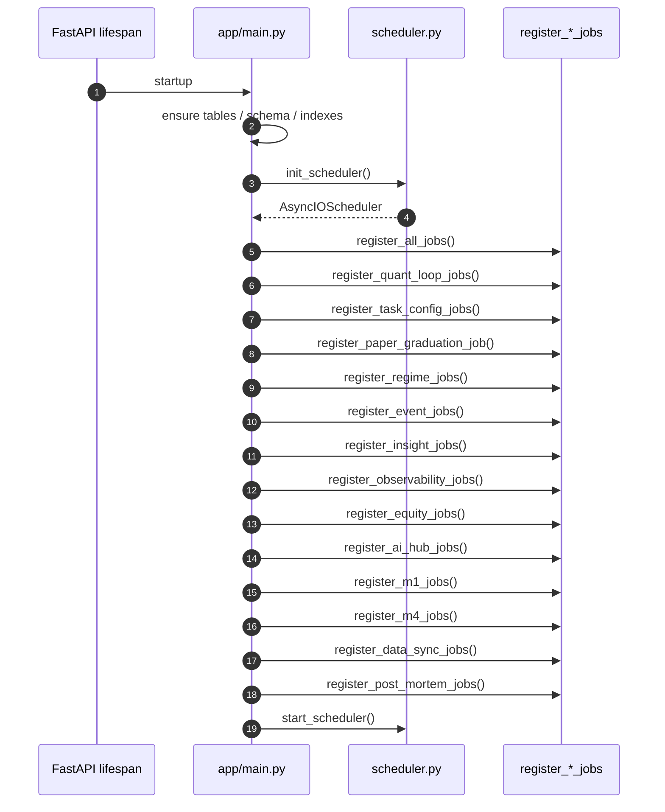
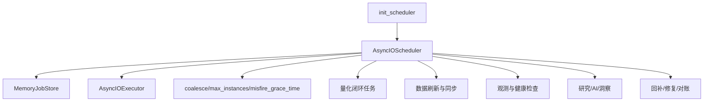
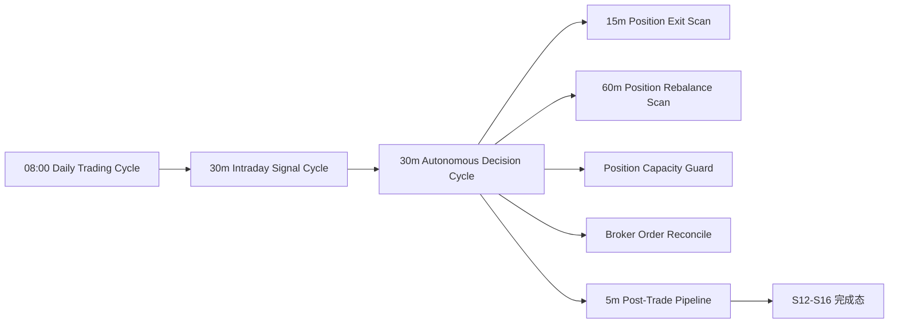
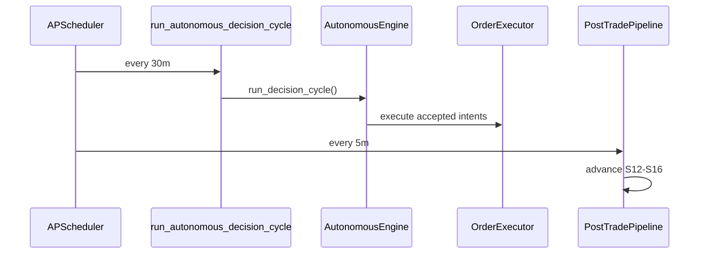
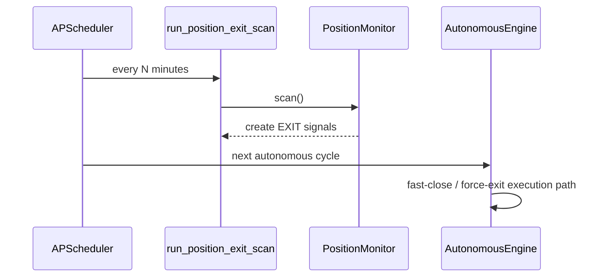

# 任务编排与后台运行机制

本文档描述系统启动时如何注册任务，以及盘中、盘后、全天候后台任务如何共同驱动系统持续运行。

## 1. 为什么任务层是核心能力

该系统很多关键能力不是同步请求触发的，而是由后台周期任务驱动：

- 日内信号生成与自动执行
- 持仓监控与风险退出
- 体制识别、事件日历、因子快照、置信度校准
- broker 对账与 post-trade 流水线推进
- 健康检查、数据回补、post-mortem 生成

## 2. 启动注册时序图

## 3. Scheduler 架构图

当前实现特点：

- 使用 `AsyncIOScheduler`
- `MemoryJobStore` 保存任务元信息
- 默认时区为 `Asia/Shanghai`
- 支持运行、暂停、关闭、重设 cron

## 4. 量化闭环任务图谱

闭环任务由 `register_quant_loop_jobs()` 集中注册，是最重要的一组 runtime jobs。

### 4.1 量化闭环任务清单

- `run_daily_trading_cycle` - 每日交易周期
- `run_intraday_signal_cycle` - 盘中增量信号生成
- `run_autonomous_decision_cycle` - 自动决策与执行主驱动
- `run_position_exit_scan` - 止损止盈超龄巡检
- `run_position_rebalance_scan` - 再平衡建议生成
- `run_position_capacity_guard` - 超并发持仓降载
- `run_broker_order_reconcile` - 券商对账
- `run_post_trade_pipeline_job` - S12-S16 推进

## 5. 任务分类矩阵

### 5.1 交易主链任务

作用：

- 驱动盘中自动交易与持仓管理

代表：

- quant loop jobs
- broker reconcile
- post-trade pipeline

### 5.2 数据与真源任务

作用：

- 刷新日历、行情相关缓存、actual_return、归因相关数据

代表：

- `register_all_jobs()` 中的数据刷新任务
- `data_sync_jobs`
- `event_jobs`
- `m1_data_loop_jobs`

### 5.3 观测与健康任务

作用：

- 保持系统监控、敞口快照、运行健康状态更新

代表：

- `observability_jobs`
- `m4_health_jobs`
- `equity_jobs`

### 5.4 研究与 AI 任务

作用：

- 做模型校准、权重更新、洞察生成、post-mortem 自动化

代表：

- `ai_hub_jobs`
- `insight_jobs`
- `post_mortem_jobs`

## 6. 关键运行链路

### 6.1 自动执行链路

### 6.2 退出链路

## 7. 运维关注点

### 7.1 为什么有 market guard

因为并不是所有任务都适合在非交易时段运行。信号生成、自动执行、持仓扫描依赖市场活跃状态，而归因、修复、对账、洞察可以跨时段运行。

### 7.2 为什么 post-trade pipeline 要单独成 job

因为成交完成并不意味着业务闭环完成。归因、洞察、A/B 实验、完成态落库都需要异步推进，单独任务更稳健，也更容易补跑。

### 7.3 为什么调度器暴露 pause/resume/reschedule

因为交易系统运维经常需要：

- 暂停某类任务避免扩大异常
- 对个别任务调时
- 在不重启应用的情况下恢复调度

## 8. 排障建议

### 8.1 任务不跑时先查什么

优先顺序：

1. `ENABLE_SCHEDULER` 是否开启
2. `init_scheduler()` 是否成功
3. 目标 `register_*_jobs()` 是否被调用
4. 任务是否存在于 scheduler jobs 列表
5. 是否因 market guard 主动跳过

### 8.2 任务跑了但业务没推进时查什么

重点检查：

- job 函数内部是否捕获并吞掉异常
- 对应服务是否因真源缺失、broker 不可用或 feature flag 而降级
- DB/Redis/Tiger/AI 服务是否健康

## 9. 相关文档

- [system-architecture.md](system-architecture.md)
- [signal-trade-position-flows.md](signal-trade-position-flows.md)
- [risk-and-governance.md](risk-and-governance.md)