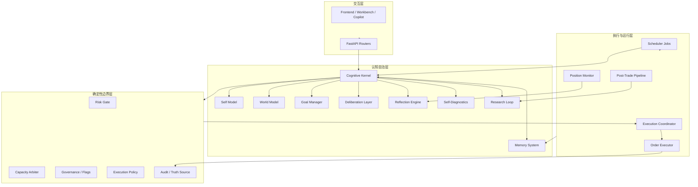
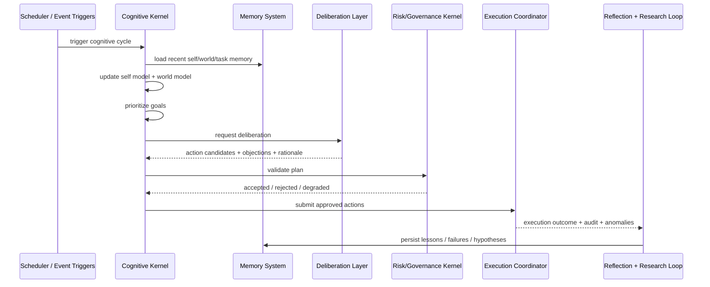

# LLM-Native Quant OS 设计提案

> 状态：提案 / 讨论稿（尚未实现）  
> 适用范围：后端认知架构、交易主链演进、自治研究与自诊断体系  
> 更新时间：2026-03-15

---

## 1. 设计动机

当前平台已经具备较强的交易控制平面能力：

- `AutonomousEngine.run_decision_cycle()` 统一自动执行主链
- `SignalQualityFunnel`、`CapacityArbiterService`、`RiskGateService`、`Circuit Breaker` 构成分层治理边界
- `MetaStateSnapshotService`、`ImprovementCandidateService`、`DecisionPostMortemService`、`CopilotService` 提供观察、解释与局部 AI 增强能力

但从架构本质看，当前系统仍然是：

> **控制平面主导的量化交易平台，LLM 作为局部分析器 / 解释器 / 辅助决策器存在。**

它还不是一个真正的 **LLM-native Quant Platform**，原因在于：

1. **交易主链仍由规则/状态机驱动**，而非由持续存在的认知内核驱动。
2. **LLM 调用仍以单次函数式调用为主**，缺少长期记忆、目标追踪、自我解释与持续反思。
3. **多智能体协作尚未成为生产主脑**，更多停留在旁路能力或专题能力层。
4. **自我优化更多体现为参数级优化**，而不是“提出研究问题 → 形成假设 → 执行实验 → 选择进化方向”的自治研究循环。
5. **故障定位仍偏运维监控式**，尚未形成 AI 驱动的根因理解与修复建议闭环。

本提案的目标，是在不破坏当前风险边界与执行纪律的前提下，将平台逐步演进为：

> **以大模型为认知中枢、以确定性风险内核为生存边界的自治量化操作系统。**

---

## 2. 目标定义

### 2.1 一句话定位

**LLM-Native Quant OS**：一个以大模型为认知内核，能够进行自我建模、世界建模、目标规划、反思纠错、自主研究和自诊断的量化交易操作系统。

### 2.2 核心原则

1. **LLM 负责认知，不直接裸奔执行。**
2. **规则层不消失，而是降级为生存边界层。**
3. **交易只是认知循环的一种输出，不是系统唯一目标。**
4. **平台必须具备连续记忆，而不是每轮重新“失忆开机”。**
5. **反思、自诊断、自主研究必须进入主循环，而不是盘后附加功能。**

---

## 3. 当前平台与目标平台的差距

| 维度 | 当前平台 | 目标平台 |
| ------ | ---------- | ---------- |
| 主脑形态 | `AutonomousEngine` + 控制平面 | `Cognitive Kernel` + 认知循环 |
| LLM 角色 | 局部分析、摘要、单次决策 | 持续感知、规划、反思、研究 |
| 驱动方式 | `pending signals -> evaluate -> execute` | `goal -> perceive -> deliberate -> plan -> act -> reflect` |
| 记忆 | 日志/审计/快照为主 | 短期工作记忆 + 中期情境记忆 + 长期原则记忆 |
| 自我优化 | 参数/权重/候选改进 | 自主提出研究问题并做实验治理 |
| 故障定位 | 健康检查 + 指标 + watchdog | 根因分析 + 修复建议 + 验证计划 |
| 多智能体 | 专题协作/旁路能力 | 主认知链 deliberation layer |

---

## 4. 目标架构总览



### 4.1 架构解释

- **认知自治层**：负责“理解、规划、解释、研究、反思”。
- **确定性边界层**：负责“什么不能做错”。
- **执行与运行层**：负责“把批准后的行动真正落地”。

当前平台最强的是第二层与第三层；未来演进重点应集中在第一层。

---

## 5. 六大原生能力

### 5.1 Self Model（自我模型）

系统需要维护自身状态，而不仅是账户状态。

应回答：

- 当前模型在哪些 regime 下最易误判？
- 当前主要收益依赖哪些因子/叙事？
- 当前是“过于保守”还是“过于激进”？
- 最近推理质量是否退化？
- 哪些 hard gate 长期阻塞资金周转？

建议输出对象：

- `self_state_snapshot`
- `decision_style_profile`
- `confidence_drift_profile`
- `failure_mode_clusters`

### 5.2 World Model（世界模型）

系统不应只读取指标，而要持续维护市场世界解释。

应覆盖：

- regime 及其可信度
- 主叙事与反叙事
- 风险簇与相关性团簇
- 事件-资产-组合的传播路径
- 价格、资金流、新闻、宏观之间的因果假设

建议输出对象：

- `market_world_state`
- `narrative_graph`
- `risk_cluster_map`
- `event_impact_hypotheses`

### 5.3 Goal Manager（目标管理）

系统需要显式回答“今天的最优行动类型是什么”，而不是只对 signal 被动响应。

目标示例：

- 提高资本效率
- 降低组合脆弱性
- 观察某叙事是否形成趋势
- 保护高价值头寸
- 进入研究模式而非交易模式

### 5.4 Reflection Engine（反思引擎）

反思需要进入主循环，覆盖：

- **事前反思**：为什么这笔交易可能错？
- **事中反思**：当前行动是否偏离 thesis？
- **事后反思**：失败来自市场、执行、认知还是治理门？
- **元反思**：最近一周的判断风格是否发生偏移？

### 5.5 Self-Diagnostics（自诊断）

自诊断能力不只是“服务挂了没”，而是“为什么系统没做出应有动作”。

需要回答：

- 为什么今天零交易？
- 为什么高置信度信号持续被拒？
- 为什么执行质量恶化？
- 为什么校准因子持续向 0.5 收敛？
- 为什么某类研究方向持续无效？

输出目标：

- `root_cause_report`
- `evidence_chain`
- `repair_recommendations`
- `verification_plan`

### 5.6 Research Loop（自治研究循环）

系统必须能把“自我优化”升级为“自我研究”。

标准闭环：

1. 发现异常/机会
2. 提出研究问题
3. 形成假设
4. 设计 shadow / paper / backtest 实验
5. 比较结果
6. 提交升级/回滚建议

这要求研究循环与治理放量严格绑定，而不是直接改 live 行为。

---

## 6. 认知循环（Cognitive Cycle）

目标系统的主循环应从当前：

```text
pending signals -> ai decide -> risk gate -> execute
```

升级为：

```text
observe -> update self/world model -> set goals -> deliberate -> generate action plan ->
deterministic validation -> execute -> reflect -> update memory
```

### 6.1 认知循环时序



---

## 7. 分层落地建议（映射当前仓库）

### 7.1 新增认知中枢目录

建议在 `app/services/` 下新增一组认知服务：

```text
app/services/
  cognitive_kernel.py
  self_model_service.py
  world_model_service.py
  goal_manager_service.py
  reflection_service.py
  self_diagnostics_service.py
  memory_service.py
  research_governor_service.py
```

### 7.2 现有服务的角色重定位

| 当前服务 | 当前角色 | 未来角色 |
| ---------- | ---------- | ---------- |
| `AutonomousEngine` | 自动执行主脑 | 降级为 `Execution Coordinator` |
| `MultiAgentOrchestrator` | 专题多智能体 | 升级为 `Deliberation Layer` 核心实现 |
| `CopilotService` | 对话接口 | 认知层的人工交互面板 |
| `MetaStateSnapshotService` | 自知画像快照 | 并入 `SelfModelService` |
| `DecisionPostMortemService` | 盘后剖析 | 并入 `ReflectionService` |
| `ImprovementCandidateService` | 改进候选生成 | 并入 `ResearchGovernorService` |

### 7.3 主链入口迁移建议

现状：

- `run_autonomous_decision_cycle` → `AutonomousEngine.run_decision_cycle()`

目标：

- `run_cognitive_cycle` → `CognitiveKernel.run_cycle()`
- `CognitiveKernel` 生成 `ActionPlan`
- `ExecutionCoordinator` 负责调用 `RiskGate` / `CapacityArbiter` / `OrderExecutor`

---

## 8. Memory System 设计

### 8.1 三层记忆

#### A. Working Memory（工作记忆）

保存本交易日/当前周期的重要上下文：

- 当前 regime
- 当前叙事
- 当前关注标的与关注风险
- 当前待决议任务

#### B. Episodic Memory（情境记忆）

保存近期发生的关键经验：

- 某类信号连续失败的上下文
- 某次执行异常的全过程
- 某个风控门长期阻塞的证据链

#### C. Semantic Memory（原则记忆）

保存平台长期稳定的经验规则：

- 哪些 regime 下应收缩激进度
- 哪些叙事经常导致虚假突破
- 哪些实验曾被证明无效

### 8.2 建议数据对象

- `cognitive_memory_entries`
- `thesis_journal`
- `reflection_episodes`
- `research_hypotheses`
- `system_principles`

---

## 9. 多智能体主链化建议

不建议把当前多智能体直接接到下单链，而应先形成 **Deliberation Layer**。

建议角色：

- `MarketSenseAgent`：市场叙事、regime、热点与拥挤度理解
- `PortfolioAgent`：组合层机会成本、风险预算、资本效率
- `RiskCriticAgent`：强制反驳与极端场景挑战
- `ExecutionAgent`：执行窗口、算法、成交风险建议
- `ReflectionAgent`：从历史 episode 中提取“别再犯什么错”
- `SREAgent`：定位数据/任务/模型/券商链路异常
- `GovernorAgent`：综合裁决并生成结构化 `ActionPlan`

### 9.1 ActionPlan 建议结构

```json
{
  "cycle_id": "uuid",
  "goal": "improve-capital-efficiency",
  "world_state_ref": "snapshot-id",
  "actions": [
    {
      "type": "TRADE_ENTRY",
      "symbol": "NVDA",
      "reason": "trend-strength + narrative confirmation + portfolio fit",
      "confidence": 0.78,
      "risk_thesis": "acceptable under current beta budget"
    }
  ],
  "objections": [
    "crowding elevated",
    "earnings event proximity"
  ],
  "fallbacks": [
    "switch to monitor-only if execution slippage > threshold"
  ]
}
```

---

## 10. 确定性边界层保持不变的部分

以下能力不应被“LLM 原生化”替代，而应保留为确定性内核：

- `RiskGateService`
- `CapacityArbiterService`
- `ExecutionPolicyService`
- execution intent 幂等保护
- circuit breaker
- 审计真源与状态迁移真源
- rollout phases 与 feature flags

原则：

> **让模型负责更聪明，但不让模型负责更鲁莽。**

---

## 11. 分阶段演进路线

### Phase 1：认知内核成型（低风险）

目标：引入 `CognitiveKernel`，但不改变 live 执行链路。

交付：

- 新增 `CognitiveKernel.run_cycle()`
- 汇总 `SelfModel` / `WorldModel` / `GoalManager`
- 输出 `ActionPlan`，仅用于 shadow/observe
- 前端 `/autonomy` 新增“认知状态”工作台

### Phase 2：多智能体 deliberation 接主链前置（中风险）

目标：将 `MultiAgentOrchestrator` 重构为 deliberation layer，但仍不直接下单。

交付：

- 输出 objections / alternatives / rationale
- 与 `ActionPlan` 绑定
- 对主链执行结果进行计划-结果偏差比对

### Phase 3：执行协调器改造（中风险）

目标：把 `AutonomousEngine` 从“思考 + 执行”拆成“执行协调器”。

交付：

- `ExecutionCoordinator` 接收 `ActionPlan`
- 原 `_ai_decide()` 退役或收缩为 fallback mechanism
- `RiskGate` / `CapacityArbiter` / audit 流程保持不变

### Phase 4：反思 / 自诊断 / 自主研究闭环（中高风险）

目标：把 `post-mortem`、`improvement candidate`、`meta-state` 统一成主循环反馈层。

交付：

- `ReflectionService`
- `SelfDiagnosticsService`
- `ResearchGovernorService`
- shadow/paper 实验治理流水线

### Phase 5：有限真实接管（高风险）

目标：只在严格 feature flag + observe/shadow/semi 纪律下，让认知内核对真实执行产生有限影响。

前提：

- replay 与审计可回放
- 认知计划与最终执行差异可比较
- 反思质量稳定
- 故障诊断有明确误报控制

---

## 12. API 与工作台建议

### 12.1 建议新增 API

```text
GET  /api/v1/cognitive/state
GET  /api/v1/cognitive/world-model
GET  /api/v1/cognitive/self-model
GET  /api/v1/cognitive/goals
GET  /api/v1/cognitive/action-plans
GET  /api/v1/cognitive/reflections
GET  /api/v1/cognitive/diagnostics
GET  /api/v1/cognitive/research-hypotheses
POST /api/v1/cognitive/run-cycle
```

### 12.2 前端建议工作台

建议在 `/autonomy` 之上增加新的认知视图：

- 当前目标与目标切换原因
- 当前市场叙事图谱
- 系统自我状态画像
- 当前 objections / alternatives / chosen plan
- 最近反思与根因诊断
- 当前研究假设队列

---

## 13. 风险与边界

### 13.1 最大风险

1. **把 LLM-native 误解为“LLM 直接替代所有确定性规则”**
2. **引入复杂 agent 但没有审计真源，导致更黑盒**
3. **没有记忆治理，导致系统持续“自我污染”**
4. **研究循环直接影响 live 行为，绕过 rollout discipline**

### 13.2 应对原则

- 所有认知输出先进入 `shadow` 观测
- 所有研究结论先进入 `paper` / `replay`
- 所有行动提案必须经过 deterministic validation
- 所有自诊断结论必须附 evidence chain

---

## 14. 结论

当前平台并非“大模型原生量化平台”，但它已经具备良好的：

- 风险边界层
- 执行内核
- 审计与治理框架
- 工作台与观测基础

因此最合理的路径不是推倒重来，而是：

> **保留当前确定性控制面作为生存边界，新增以 `CognitiveKernel` 为核心的认知自治层，逐步把平台从“规则主导 + LLM 辅助”演进为“LLM 认知主导 + 风险内核托底”的 Quant OS。**

这也是当前仓库在工程上最现实、最安全、也最符合你目标愿景的方向。
