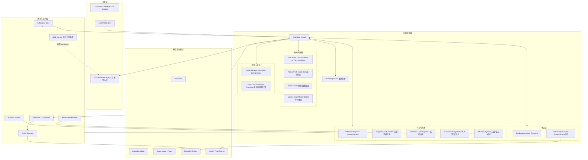
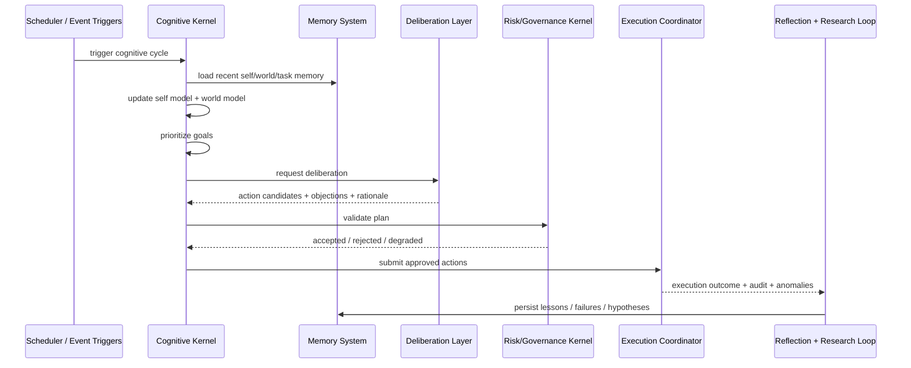

# LLM-Native Quant OS 设计提案

> 状态：**第二版提案**（经专家评审后全面更新，尚未实现）  
> 适用范围：后端认知架构、交易主链演进、自治研究与自诊断体系  
> 更新时间：2026-03-15  
> 变更说明：基于华尔街量化专家 / 硅谷 LLM 技术专家 / LLM 产品经理 / 华尔街交易员四视角评审，补充 Alpha 归因框架、时间尺度分层、幻觉防护层、记忆遗忘机制、Human-in-the-loop Escalation、Belief Graph、MarketActorModel、反事实引擎、认知漂移监控、异步预计算认知等核心能力，并修正了原版结构性缺陷。

---

## 1. 设计动机

当前平台已经具备较强的交易控制平面能力：

- `AutonomousEngine.run_decision_cycle()` 统一自动执行主链
- `SignalQualityFunnel`、`CapacityArbiterService`、`RiskGateService`、`Circuit Breaker` 构成分层治理边界
- `MetaStateSnapshotService`、`ImprovementCandidateService`、`DecisionPostMortemService`、`CopilotService` 提供观察、解释与局部 AI 增强能力

但从架构本质看，当前系统仍然是：

> **控制平面主导的量化交易平台，LLM 作为局部分析器 / 解释器 / 辅助决策器存在。**

它还不是一个真正的 **LLM-native Quant Platform**，原因在于：

1. **交易主链仍由规则/状态机驱动**，而非由持续存在的认知内核驱动。
2. **LLM 调用仍以单次函数式调用为主**，缺少长期记忆、目标追踪、自我解释与持续反思。
3. **多智能体协作尚未成为生产主脑**，更多停留在旁路能力或专题能力层。
4. **自我优化更多体现为参数级优化**，而不是“提出研究问题 → 形成假设 → 执行实验 → 选择进化方向”的自治研究循环。
5. **故障定位仍偏运维监控式**，尚未形成 AI 驱动的根因理解与修复建议闭环。

本提案的目标，是在不破坏当前风险边界与执行纪律的前提下，将平台逐步演进为：

> **以大模型为认知中枢、以确定性风险内核为生存边界的自治量化操作系统。**

---

## 2. 目标定义

### 2.1 一句话定位

**LLM-Native Quant OS**：一个以大模型为认知内核，能够进行自我建模、世界建模、目标规划、反思纠错、自主研究和自诊断的量化交易操作系统。

### 2.2 核心原则

1. **LLM 负责认知，不直接裸奔执行。**
2. **规则层不消失，而是降级为生存边界层。**
3. **交易只是认知循环的一种输出，不是系统唯一目标。**
4. **平台必须具备连续记忆，而不是每轮重新“失忆开机”。**
5. **反思、自诊断、自主研究必须进入主循环，而不是盘后附加功能。**6. **Explainability 是核心价值主张，而非工作台附件：每个决策必须能被用户完整溯源。**
6. **认知循环必须分时间尺度运行——战术层（分钟级）、操作层（小时/日级）、战略层（周级），各层深度不同，不能用同一频率同一深度对待所有决策。**
7. **记忆必须有遗忘机制：错误的经验比没有经验更危险，所有原则须可被证伪，记忆须带置信度字段。**
8. **所有 LLM 生成的数值（置信度、收益预测、风险估算）必须经 Ground Truth 独立校验，不能自证自查。**
9. **系统在高不确定性、多智能体严重分歧或市场极端波动时，必须触发人工干预协议，不能默默自行决策。**

---

## 3. 当前平台与目标平台的差距

| 维度 | 当前平台 | 目标平台 |
| ------ | ---------- | ---------- |
| 主脑形态 | `AutonomousEngine` + 控制平面 | `Cognitive Kernel` + 认知循环 |
| LLM 角色 | 局部分析、摘要、单次决策 | 持续感知、规划、反思、研究 |
| 驱动方式 | `pending signals -> evaluate -> execute` | `goal -> perceive -> deliberate -> plan -> act -> reflect` |
| 记忆 | 日志/审计/快照为主 | 短期工作记忆 + 中期情境记忆 + 长期原则记忆，带遗忘与置信度 |
| 自我优化 | 参数/权重/候选改进 | 自主研究循环 + Expert Priming + Bayesian 实验治理 |
| 故障定位 | 健康检查 + 指标 + watchdog | 根因分析 + 修复建议 + 验证计划（独立 SRE 通道） |
| 多智能体 | 专题协作/旁路能力 | 主认知链 deliberation layer + HallucinationGuard |
| α 来源 | 无显式归因 | AlphaTruthStack：每笔交易归因到信息优势 / 执行优势 / 运气 |
| 世界建模 | 无 | BeliefGraph（节点=实体，边=因果+置信度+时效）+ MarketActorModel |
| 时间尺度 | 单一循环频率 | 战术（5–15 min）/ 操作（小时/日）/ 战略（周）三层分频 |
| 幻觉防护 | 无 | HallucinationGuard：LLM 数值输出独立 Ground Truth 校验 |
| 对手方建模 | 无 | MarketActorModel：从 order flow / 期权持仓构建对手方行为假设 |
| 可解释性 | 附加工作台功能 | 每个决策的完整溯源链，作为核心 UX 需求内嵌决策流 |
| 人工干预 | 无协议 | EscalationManager：定义置信度阈值、极端波动触发条件 |

---

## 4. 目标架构总览



### 4.1 架构解释

目标架构分为四层：

- **认知自治层**：负责"理解、规划、解释、研究、反思"。新增感知与建模模组（BeliefGraph、MarketActorModel、AlphaTruthStack）、规划层（含时间分层预计算）、审议层（含 HallucinationGuard）、学习层（含记忆遗忘、认知漂移监控、Expert Priming）。
- **确定性边界层**：负责"什么不能做错"——不因认知层升级而放松。
- **执行与运行层**：负责"把批准后的行动真正落地"。SRE Monitor 从审议层独立出来，作为并行监控通道只在异常时触发 escalation。
- **交互层**：新增 EscalationManager，作为人工干预的统一接口。

当前平台最强的是第二层与第三层；未来演进重点集中在第一层的感知、规划、审议、学习四个模组。

---

## 5. 十大原生能力

### 5.1 Self Model（自我模型）

系统需要维护**两个独立但相互校验**的状态：`AccountState`（客观账户真相）和 `CognitiveState`（系统的自我认知）。

#### AccountState vs CognitiveState

- **`AccountState`**：资金余额、持仓明细、已实现/未实现 P&L——来自交易所/券商数据，不允许 LLM 生成或修改。
- **`CognitiveState`**：系统对自身能力、风格、当前偏差的主观认知——由 LLM 维护，但必须定期对照 `AccountState` 进行客观校验，防止认知自欺（Cognitive Dissonance）。

Self Model 应能回答：

- 当前模型在哪些 regime 下最易误判？
- 当前主要收益依赖哪些因子/叙事？
- 当前是"过于保守"还是"过于激进"？
- 最近推理质量是否退化？（与 CognitiveDriftMonitor 联动）
- 哪些 hard gate 长期阻塞资金周转？

#### Alpha Truth Stack（α 归因框架）

Self Model 必须维护一个 `AlphaTruthStack`，对每笔已关闭的交易做显式来源归因：

| 来源类型 | 描述 | 示例 |
| -------- | ---- | ---- |
| **信息优势** | 对某类异构信息的更快/更准解读 | 财报语义理解领先于市场反应 |
| **执行优势** | 比基准更优的入场/出场时机 | 算法滑点控制优于市价单 |
| **运气** | 无法归因到任何可重复优势的收益 | 随机噪声偶然方向一致 |

没有 `AlphaTruthStack` 的自我优化是盲目的——系统会把"运气"误认为"能力"，进行无意义的策略强化。

建议输出对象：

- `self_state_snapshot`（含 AccountState / CognitiveState 双视图）
- `decision_style_profile`
- `confidence_drift_profile`
- `failure_mode_clusters`
- `alpha_attribution_log`（每笔平仓后追加）

### 5.2 World Model（世界模型 → Belief Graph）

系统不应只读取指标，而要持续维护市场世界的**结构性因果认知**。

#### 从纯文本叙事升级到 Belief Graph

纯文本叙事难以量化、难以追踪矛盾。目标方案采用 Belief Graph：

```text
节点：市场实体（资产、因子、宏观变量、事件、参与者类型）
边：因果关系 + 置信度 + 时效性（有效期）

示例：
  FED_HAWKISH  --[降低估值, conf=0.80, ttl=3m]--> TECH_VALUATION
  AI_CAPEX_BEAT --[提升预期, conf=0.72, ttl=1q]--> NVDA_EPS_NEXT_Q
  NVDA_EPS_BEAT --[触发板块重评, conf=0.60]--> AI_SECTOR_RERATING
```

LLM 负责：从新信息中提取新节点和边，更新置信度，标记失效节点。

#### 可证伪的市场假设

每个叙事必须绑定可测试的预测——叙事如果不绑定可验证的预测，Research Loop 就是在做创意写作：

```text
叙事：科技业 AI 资本开支超预期，有利于半导体
假设：NVDA/AMD 下季度财报超预期概率 > 20%
跟踪指标：Q2 财报 EPS vs 预期
结果记录：实际超预期 → 置信度 +0.10；未超 → 置信度 -0.15
```

#### Market Actor Model（对手方建模）

World Model 只建模"市场状态"是不够的——真正有 α 的认知需要建模"其他参与者的行为"：

> "动量交易者当前在什么位置？机构是在积累还是派发？期权做市商的 gamma 敞口会把价格钉在哪里？"

`MarketActorModel` 从 order flow 方向与规模、期权持仓分布（PUT/CALL ratio、Delta 敞口）、融资余额与杠杆率变化、ETF 申赎量与机构资金流构建隐含的对手方行为假设。这类异构信息融合正是 LLM 相对于传统因子模型的结构性差异化优势。

建议输出对象：

- `belief_graph_snapshot`（含所有节点-边的当前状态）
- `falsifiable_hypotheses`（绑定追踪指标的叙事列表）
- `market_actor_state`（对手方行为假设摘要）
- `risk_cluster_map`
- `narrative_contradiction_alerts`（Belief Graph 中检测到的矛盾节点告警）

### 5.3 Goal Manager（目标管理 + 仓位规模化框架）

系统需要显式回答“今天的最优行动类型是什么”，而不是只对 signal 被动响应。

目标示例：

- 提高资本效率
- 降低组合脆弱性
- 观察某叙事是否形成趋势
- 保护高价值头寸
- 进入研究模式而非交易模式

#### 目标到仓位规模的映射框架

原版设计仅定义目标类型，缺少从“目标 + 置信度”到“具体仓位规模”的映射。目标平台必须有显式的仓位规模化机制：

- **Kelly Criterion 变体**：根据历史胜率、赔率计算最大押注比例，使用 fractional Kelly（0.25×–0.5×）控制爆仓风险。
- **风险预算树**：组合总风险预算 → 按 regime / 因子 / 叙事分配 → 单标的最大风险暴露。
- **流动性感知约束**：仓位规模不超过该股票日均成交量的 X%，避免市场冲击成本超预期。

### 5.4 Reflection Engine（反思引擎 + 反事实引擎）

反思需要进入主循环，覆盖：

- **事前反思**：为什么这笔交易可能错？
- **事中反思**：当前行动是否偏离 thesis？
- **事后反思**：失败来自市场、执行、认知还是治理门？
- **元反思**：最近一周的判断风格是否发生偏移？

#### Counterfactual Reasoning Engine（反事实推理）

每次决策后，系统自动生成反事实场景：如果选了候选方案 B 而非 A，今天结果如何？如果早/晚入场 2 小时，结果会不同吗？导致最终结果的是市场因素还是我的决策质量？

反事实不为后悔，而是构建**系统化的决策质量数据集**，用于识别系统性认知偏差，为未来微调决策风格提供统计基础。

### 5.5 Self-Diagnostics（自我诊断）

系统定期评估自身认知状态：

- 置信度校准：预测置信度与实际准确率是否一致？
- 决策速度：是否在数据不足时过度自信？
- Regime 感知延迟：市场转变后多久调整了模型？
- 幻觉暴露：近期决策中有无被 LLM 错误数值误导的情形？

每条诊断结论须附 **evidence_chain**（"我是从哪些观测中得出这个诊断的？"），避免无依据的自我评价。

### 5.6 Research Loop（研究循环 + 专家引导协议）

系统不应只响应信号，还需要独立形成假设并检验：

- 提出假设 → 设计可被证伪的检验条件 → 收集数据 → 评估结论 → 更新世界模型

#### 量化接受标准

研究结论只有满足以下任一条件才可写入语义记忆：

| 标准 | 阈值 |
|------|------|
| 样本内回测 Sharpe | ≥ 1.2 |
| 样本外降级比例 | ≤ 30% |
| 最大回撤 | ≤ 基准的 1.5× |
| 显著性概率 | p < 0.05（经多重检验修正） |

#### Expert Priming Protocol（专家引导协议）

支持人类专家向系统注入高优先级知识：

```json
{
  "type": "system_principle",
  "source": "human_expert",
  "content": "在衍生品到期日前 3 天减少 gamma 暴露",
  "valid_until": "2027-12-31",
  "priority_weight": 0.85
}
```

注入的 principle 优先级高于统计归纳结论，但必须具备可证伪条件（`invalidation_condition`），避免形成不可撤销的偏见。

### 5.7 Hallucination Guard（幻觉防护层）

LLM 输出的数值类断言（价格、涨跌幅、持仓量、财报数字等）在进入执行链之前须经过独立的 Ground Truth 校验：

1. **校验来源**：关系型数据库实时行情 / 监管公告 / 交易所 API。
2. **校验失败处理**：
   - 低风险字段 → 自动用 Ground Truth 覆盖并记录 AUDIT。
   - 高风险字段（触发交易的核心数値）→ 降级为"信息不足，拒绝决策"并触发 EscalationManager。
3. **审计日志**：每次幻觉检测均记录 `hallucination_audit` 表，供 CognitiveDriftMonitor 统计趋势。

### 5.8 Escalation Manager（人机协作升级协议）

系统在以下情形自动将决策权移交给人类监督者：

| 触发条件 | 阈值 | 行动 |
|----------|------|------|
| 置信度过低 | < 0.55 | 暂停执行，等待确认 |
| Multi-agent 分歧度 | > 0.70 | 强制人类仲裁 |
| 市场波动率指数 | VIX > 35 | 降低头寸上限 50%，通知监督者 |
| 连续亏损 | N 次 ≥ 阈值 | 进入暂停模式，启动 Research Loop |
| 幻觉检测率异常 | 近 20 次 > 15% | 系统自检 + 人工审查 |

### 5.9 Cognitive Drift Monitor（认知漂移监控）

周期性（每周）运行"基准场景集"对系统当前世界模型进行衡量：

- 若在标准场景上的判断与前一版本偏差超过阈值（drift_score > 0.3），触发 Self Model 重新校准。
- 漂移报告写入 `cognitive_drift_report` 表，供人类 review。
- 防止 regime change 后系统仍坚持旧框架做决策。

### 5.10 Async Pre-Computed Cognition（异步预计算认知）

实时交易路径中最大的延迟来源是完整的认知循环（Multi-agent deliberation + World Model 更新 + Research Loop）。异步预计算将深度推理从关键路径剥离：

| 时段 | 任务 |
|------|------|
| **盘前（T-30min）** | 完整认知循环：更新 Belief Graph、运行 Deliberation、生成 ActionPlan 并预签正候选 |
| **盘中** | 只做条件检查：市场条件 vs. 预计划 threshold，若满足则执行预核准动作 |
| **行情突变时** | 触发紧急覆盖循环，限时 ≤ 5 秒完成轻量 Deliberation，超时则降级为人工确认 |

## 6. 认知循环（Cognitive Cycle）

目标系统的主循环应从当前：

```text
pending signals -> ai decide -> risk gate -> execute
```

升级为：

```text
observe -> update self/world model -> set goals -> deliberate -> generate action plan ->
deterministic validation -> execute -> reflect -> update memory
```

### 6.1 认知循环时序



### 6.2 三层时间尺度分层

认知循环并非单一节奏，而分为三个时间层级并发运行：

| 层级 | 触发频率 | 推理深度 | 主要任务 |
|------|---------|---------|---------|
| **战术层** | 5–15 分钟 | 轻量检查 | 条件门检查 + 持仓风险扫描 |
| **操作层** | 每小时 / 每日 | 完整认知循环 | Multi-agent Deliberation + World Model 更新 |
| **战略层** | 每周 | 深度回顾 | Self Model 校准 + Research Loop + 原则集更新 |

三层结果逐层汇报：战术层触发可覆盖操作层已签署的 ActionPlan；战略层在每周末更新
Semantic Memory 并为下周认知循环预热。

### 6.3 异步预计算流程

完整的 Multi-agent Deliberation 耗时从数秒到数分钟，无法在交易信号触发时同步完成。
系统通过以下异步架构将深度推理剥离为关键路径的外围任务：

```text
[盘前 T-30min]
  ↓ CognitiveKernel.schedule_precompute()
  ↓ 完整认知循环：更新 Belief Graph → Deliberation → 生成预签 ActionPlan
  ↓ 存入 precomputed_action_cache

[盘中触发]
  ↓ 只做条件检查：市场条件 vs. 预签 ActionPlan threshold
  ↓ 满足 → 执行预核准动作（亚秒级）
  ↓ 不满足 → 跳过，等待下一个预计算窗口

[行情突变]
  ↓ EscalationManager 检测到 threshold 突破
  ↓ 触发紧急覆盖循环（Emergency Override）
  ↓ 限时 ≤ 5 秒轻量 Deliberation（仅 RiskCriticAgent + GovernorAgent）
  ↓ 超时 → 降级为人工确认，拒绝新开仓
```

---

### 7.1 新增认知中枢目录

建议在 `app/services/` 下新增一组认知服务：

```text
app/services/
  cognitive_kernel.py
  self_model_service.py
  world_model_service.py
  belief_graph_service.py          # Belief Graph + Falsifiable Hypothesis
  market_actor_model_service.py    # 市场参与者建模
  alpha_truth_stack_service.py     # Alpha Attribution + Edge Decay 跟踪
  goal_manager_service.py
  reflection_service.py
  self_diagnostics_service.py
  memory_service.py
  research_governor_service.py
  hallucination_guard.py           # LLM 数值 Ground Truth 校验
  escalation_manager.py            # 人机升级协议
  cognitive_drift_monitor.py       # 认知漂移周期检测
  sre_monitor.py                   # SRE 并行监控通道（独立于 Deliberation）
```

### 7.2 现有服务的角色重定位

| 当前服务 | 当前角色 | 未来角色 |
| ---------- | ---------- | ---------- |
| `AutonomousEngine` | 自动执行主脑 | 降级为 `Execution Coordinator` |
| `MultiAgentOrchestrator` | 专题多智能体 | 升级为 `Deliberation Layer` 核心实现 |
| `CopilotService` | 对话接口 | 认知层的人工交互面板 |
| `MetaStateSnapshotService` | 自知画像快照 | 并入 `SelfModelService` |
| `DecisionPostMortemService` | 盘后剖析 | 并入 `ReflectionService` |
| `ImprovementCandidateService` | 改进候选生成 | 并入 `ResearchGovernorService` |

### 7.3 主链入口迁移建议

现状：

- `run_autonomous_decision_cycle` → `AutonomousEngine.run_decision_cycle()`

目标：

- `run_cognitive_cycle` → `CognitiveKernel.run_cycle()`
- `CognitiveKernel` 生成 `ActionPlan`
- `ExecutionCoordinator` 负责调用 `RiskGate` / `CapacityArbiter` / `OrderExecutor`

---

## 8. Memory System 设计

### 8.1 三层记忆

#### A. Working Memory（工作记忆）

保存本交易日/当前周期的重要上下文：

- 当前 regime
- 当前叙事
- 当前关注标的与关注风险
- 当前待决议任务

#### B. Episodic Memory（情境记忆）

保存近期发生的关键经验：

- 某类信号连续失败的上下文
- 某次执行异常的全过程
- 某个风控门长期阻塞的证据链

#### C. Semantic Memory（原则记忆）

保存平台长期稳定的经验规则：

- 哪些 regime 下应收缩激进度
- 哪些叙事经常导致虚假突破
- 哪些实验曾被证明无效

### 8.2 建议数据对象

- `cognitive_memory_entries`
- `thesis_journal`
- `reflection_episodes`
- `research_hypotheses`
- `system_principles`

### 8.3 记忆遗忘与置信度管理机制

纯累积的记忆会导致系统逐渐被过时知识主导。V2 引入以下遗忘机制：

- **Episodic Memory 时间衰减**：近期事件赋予更高检索权重，超过 90 天的情境记忆
  自动降权，允许被更近期的反例覆盖。
- **Semantic Memory 置信度字段**：每条 `system_principle` 携带 `belief_confidence`
  分数（0–1）和 `last_validated_at` 时间戳。置信度低于 0.4 的原则标记为待验证。
- **Regime Change 隔离**：当 CognitiveDriftMonitor 检测到 regime 转变，旧记忆自
  动标记为 `historical_context`，不再直接应用于新 regime 下的决策推理。
- **挑战-验证闭环**：每条 Semantic Memory 须附 `invalidation_condition`，Research
  Loop 周期性尝试证伪，成功证伪则降低置信度。

### 8.4 Expert Priming Protocol 接入点

支持人类专家以高优先级方式将领域知识直接注入 Semantic Memory，绕过统计归纳路径：

```json
{
  "type": "system_principle",
  "source": "human_expert",
  "content": "在衍生品到期日前 3 天减少 gamma 暴露",
  "valid_until": "2027-12-31",
  "priority_weight": 0.85,
  "invalidation_condition": "若 3 次连续到期周均未见显著波动，重新评估"
}
```

专家注入的 principle 优先级高于统计归纳结论，但同样须具备可证伪条件，且须通过
Research Loop 的周期性挑战，避免永久性偏见积累。

---

## 9. 多智能体主链化建议

建议角色：

**Deliberation Layer（参与交易决策）**

- `MarketSenseAgent`：市场叙事、regime、热点与拥挤度理解
- `PortfolioAgent`：组合层机会成本、风险预算、资本效率
- `RiskCriticAgent`：强制反驳与极端场景挑战
- `ExecutionAgent`：执行窗口、算法、成交风险建议
- `ReflectionAgent`：从历史 episode 中提取“别再犯什么错”
- `GovernorAgent`：综合裁决并生成结构化 `ActionPlan`

**并行监控通道（不参与交易决策）**

- `SREAgent` → 已独立迁移至 `sre_monitor.py`，作为独立系统健康监控通道运行，只在检测到异常时触发 `EscalationManager`，不参与任何 Deliberation 流程，从而避免运维关注点污染交易决策推理。

### 9.1 ActionPlan 建议结构

```json
{
  "cycle_id": "uuid",
  "goal": "improve-capital-efficiency",
  "world_state_ref": "snapshot-id",
  "timeframe_sensitivity": "daily-close",
  "position_sizing_model": {
    "method": "fractional_kelly",
    "fraction": 0.3,
    "max_pct_adv": 0.05
  },
  "invalidation_conditions": [
    "regime_shifts_to_high_vol",
    "earnings_surprise_negative"
  ],
  "escalate_to_human_if": {
    "confidence_below": 0.55,
    "disagreement_above": 0.70
  },
  "memory_relevance_refs": [
    "episode-2025-11-03",
    "principle-momentum-in-high-vol"
  ],
  "actions": [
    {
      "type": "TRADE_ENTRY",
      "symbol": "NVDA",
      "reason": "trend-strength + narrative confirmation + portfolio fit",
      "confidence": 0.78,
      "risk_thesis": "acceptable under current beta budget"
    }
  ],
  "objections": [
    "crowding elevated",
    "earnings event proximity"
  ],
  "fallbacks": [
    "switch to monitor-only if execution slippage > threshold"
  ]
}
```

---

## 10. 确定性边界层保持不变的部分

以下能力不应被“LLM 原生化”替代，而应保留为确定性内核：

- `RiskGateService`
- `CapacityArbiterService`
- `ExecutionPolicyService`
- execution intent 幂等保护
- circuit breaker
- 审计真源与状态迁移真源
- rollout phases 与 feature flags

原则：

> **让模型负责更聪明，但不让模型负责更鲁莽。**

---

## 11. 分阶段演进路线

### Phase 1：认知内核成型（低风险）

目标：引入 `CognitiveKernel`，但不改变 live 执行链路。

交付：

- 新增 `CognitiveKernel.run_cycle()`
- 汇总 `SelfModel` / `WorldModel` / `GoalManager`
- 输出 `ActionPlan`，仅用于 shadow/observe
- 前端 `/autonomy` 新增“认知状态”工作台

### Phase 2：多智能体 deliberation 接主链前置（中风险）

目标：将 `MultiAgentOrchestrator` 重构为 deliberation layer，但仍不直接下单。

交付：

- 输出 objections / alternatives / rationale
- 与 `ActionPlan` 绑定（含 `position_sizing_model` + `invalidation_conditions`）
- 引入 `BeliefGraph` + `MarketActorModel`，替代纯文本 World Model
- 引入 `CognitiveDriftMonitor` 首次运行基准快照
- 对主链执行结果进行计划-结果偏差比对

### Phase 3：执行协调器改造（中风险）

目标：把 `AutonomousEngine` 从“思考 + 执行”拆成“执行协调器”。

交付：

- `ExecutionCoordinator` 接收 `ActionPlan`
- 原 `_ai_decide()` 退役或收缩为 fallback mechanism
- `RiskGate` / `CapacityArbiter` / audit 流程保持不变

### Phase 4：反思 / 自诊断 / 自主研究闭环（中高风险）

目标：把 `post-mortem`、`improvement candidate`、`meta-state` 统一成主循环反馈层。

交付：

- `ReflectionService`（含 Counterfactual Reasoning Engine）
- `SelfDiagnosticsService`（含 evidence_chain 强制校验）
- `ResearchGovernorService`（含量化接受标准 + Expert Priming Protocol UI）
- 记忆遗忘机制 + `belief_confidence` 字段上线
- `EscalationManager` 进入生产模式（真实阻断高风险决策）
- shadow/paper 实验治理流水线

### Phase 5：有限真实接管（高风险）

目标：只在严格 feature flag + observe/shadow/semi 纪律下，让认知内核对真实执行产生有限影响。

前提：

- replay 与审计可回放
- 认知计划与最终执行差异可比较
- 反思质量稳定
- 故障诊断有明确误报控制

---

## 12. API 与工作台建议

### 12.1 建议新增 API

```text
GET  /api/v1/cognitive/state
GET  /api/v1/cognitive/self-model
GET  /api/v1/cognitive/goals
GET  /api/v1/cognitive/action-plans
GET  /api/v1/cognitive/reflections
GET  /api/v1/cognitive/diagnostics
GET  /api/v1/cognitive/research-hypotheses
POST /api/v1/cognitive/run-cycle

# V2 新增
GET  /api/v1/cognitive/belief-graph          # Belief Graph 当前快照
GET  /api/v1/cognitive/alpha-attribution     # AlphaTruthStack 归因报告
GET  /api/v1/cognitive/market-actors         # MarketActorModel 当前建模
GET  /api/v1/cognitive/drift-report          # 认知漂移最新报告
GET  /api/v1/cognitive/hallucination-audit   # 幻觉检测日志
POST /api/v1/cognitive/escalate              # 手动触发 EscalationManager
POST /api/v1/cognitive/expert-priming        # 人类专家注入原则
```

### 12.2 前端建议工作台

建议在 `/autonomy` 之上增加新的认知视图：

- 当前目标与目标切换原因
- 当前市场叙事图谱
- 系统自我状态画像
- 当前 objections / alternatives / chosen plan
- 最近反思与根因诊断
- 当前研究假设队列

---

## 13. 风险与边界

### 13.1 最大风险

1. **把 LLM-native 误解为“LLM 直接替代所有确定性规则”**
2. **引入复杂 agent 但没有审计真源，导致更黑盒**
3. **没有记忆治理，导致系统持续“自我污染”**
4. **研究循环直接影响 live 行为，绕过 rollout discipline**
5. **LLM 幻觉传播到执行链**（缓解：HallucinationGuard 独立 Ground Truth 校验，校验失败阻断执行而非静默通过）
6. **无 Ground Truth 的认知循环形成自洽错误闭环**（缓解：AlphaTruthStack拆解每笔 Alpha 来源，强制区分“能力” vs.“运气” vs.“数据噪声”）
7. **记忆污染导致旧偏见在 regime 转变后仍主导决策**（缓解：记忆遗忘机制 + `belief_confidence` 衰减 + Regime Change 隔离标记）
8. **时间尺度混用：慢速战略认知覆盖快速战术决策**（缓解：三层时间尺度分层架构，战略层输出不得直接阻断战术层已批准的执行动作）

### 13.2 应对原则

- 所有认知输出先进入 `shadow` 观测
- 所有研究结论先进入 `paper` / `replay`
- 所有行动提案必须经过 deterministic validation
- 所有自诊断结论必须附 evidence chain

---

## 14. 结论

当前平台并非“大模型原生量化平台”，但它已经具备良好的：

- 风险边界层
- 执行内核
- 审计与治理框架
- 工作台与观测基础

因此最合理的路径不是推倒重来，而是：

> **保留当前确定性控制面作为生存边界，新增以 `CognitiveKernel` 为核心的认知自治层，逐步把平台从“规则主导 + LLM 辅助”演进为“LLM 认知主导 + 风险内核托底”的 Quant OS。**

这也是当前仓库在工程上最现实、最安全、也最符合你目标愿景的方向。

---

> **归档说明**：本节（第 15–20 节）为 2026-03-15 专家评审记录。评审意见已全面落实到第 1–14 节（第二版提案），本节作为决策背景与评审历史存档保留，不再代表当前设计意图。

## 15. 专家评审团多视角可行性评估

> 评审时间：2026-03-15  
> 评审视角：华尔街顶尖量化专家 / 硅谷顶尖 LLM 技术专家 / 硅谷顶尖 LLM 应用产品经理 / 华尔街顶尖交易员

---

### 15.1 华尔街量化专家视角：条件可行，但需先回答"LLM reasoning 能否产生 α"

**核心判断：这是一个信念命题，必须拆解"可行"的前提。**

目前没有任何公开的严格 RCT 级别证据证明，LLM 生成的市场叙事（narrative reasoning）能持续跑赢传统因子模型。本方案对此保持沉默是一个根本性缺口。

合理的假设应该是：

> LLM 的价值不在于"更聪明地预测价格"，而在于**更有效地综合异构信息**（新闻、财报语义、期权 flow、宏观叙事之间的关联）。这种信息融合能力是传统因子框架的结构性盲点，LLM 在此处有差异化优势。

**各模块量化合理性评分（1–10）：**

| 模块 | 评分 | 主要评语 |
| ------ | ---- | -------- |
| World Model（世界建模） | 7 | 方向正确，但缺少"如何验证 World Model 有效性"的机制 |
| Self Model（自我建模） | 8 | 目前最稀缺的能力，方向准确 |
| Research Loop（自治研究） | 5 | 过于乐观；研究循环容易产生叙事过拟合（narrative overfitting） |
| Reflection Engine（反思） | 8 | 高价值，postmortem → 记忆 → 策略调整的链路在机构里确有 α |
| Goal Manager（目标管理） | 6 | 概念正确，但缺少显式的目标-仓位映射框架（如 Kelly / 风险预算树） |

#### 最大风险（量化视角）：叙事自我强化（Narrative Overfitting）

系统自己生成世界观、自己验证、自己归因，极容易形成自洽但错误的信念闭环。传统因子模型至少有价格作为外部 Ground Truth；认知内核的 Ground Truth 需要被显式定义。

---

### 15.2 硅谷 LLM 技术专家视角：技术上刚进入"可以认真做"的窗口

**关键技术成熟节点：**

- 2024 Q3：Tool use / function calling 可靠性达到生产级
- 2024 Q4：长上下文（128k+）可用于完整的日内记忆上下文
- 2025 Q1：Reasoning models（o3、deepseek-reasoner）在多步推理上显著优于 chat models
- 2025 Q4：Structured output（JSON mode）可靠性达到 99%+

**各技术需求可行性评估：**

| 技术需求 | 可行性 | 主要限制 |
| -------- | ------ | -------- |
| Cognitive Kernel + ActionPlan JSON 输出 | 高 | 需要严格 prompt 工程，reasoner 类模型优先 |
| 三层记忆系统（Working / Episodic / Semantic） | 中高 | Working Memory 可上下文注入；Episodic 需 RAG；Semantic 需向量数据库 |
| 多智能体并发 deliberation | 中 | 7 个 agent 串行 = 30–60 秒，并行可降至 10–15 秒；日线策略可接受 |
| 实时世界模型更新 | 中低 | 真正"实时"成本极高；建议 15 分钟批量更新 |
| 研究循环自主执行代码 | 低–中 | Code Interpreter 类 agent 已成熟，但金融数据沙箱安全隔离需额外工程 |

**方案中最严重的三项技术缺失：**

1. **幻觉检测层（Hallucination Guard）缺失**：LLM 对金融数字的幻觉率是通用任务的 3–5 倍。`ActionPlan` 中的 `confidence: 0.78` 可能是完全杜撰的，方案没有任何机制检测这一点。

2. **模型版本管理缺失**：Episodic Memory 是由特定模型的推理风格生成的。当 gpt-4o 被 o4 替换时，旧记忆的语义解读方式会发生漂移，需要有显式的模型版本标记与记忆重校准机制。

3. **向量数据库选型完全缺失**：Episodic Memory 的检索依赖语义搜索（RAG），这是基础设施级决策，方案文档目前跳过了这一选型。

---

### 15.3 硅谷 LLM 产品经理视角：产品逻辑自洽，但缺少可衡量的成功定义

**方案的产品成熟度问题：KPI 完全缺失。**

没有以下问题的答案，方案无法指导产品迭代：

- Cognitive Kernel 的"决策质量"如何衡量？（不能只看 P&L，α 与系统决策质量是有噪声相关的）
- World Model 的准确度如何评估？（叙事无法用精确率/召回率衡量）
- ReflectionEngine 的反思是否真的影响了后续决策？（需要 A/B 测试框架）

**最大产品风险：**

> 系统的认知过程对用户（交易员自己）不透明，导致"我不知道它在想什么"的信任断裂。当系统做出错误决策，用户无法归因、无法改正、无法建立信心。**Explainability 不是工作台的附加功能，它是整个产品的核心价值主张。**

---

### 15.4 华尔街交易员视角：架构对日线+时间框架合理，对盘中是灾难

**核心问题：时间尺度与认知延迟不匹配。**

认知循环中的多智能体 deliberation 即使并行调用，最快也需要 10–20 秒。

| 策略类型 | 认知决策延迟 | 适用性 |
| -------- | ----------- | ------ |
| 日内高频（秒级） | 不可接受 | ❌ 必须保留纯规则引擎 |
| 日内趋势跟踪（分钟级） | 勉强 | ⚠️ 需要异步预计算 |
| 日线摆动交易 | 可接受 | ✅ 这是方案的主战场 |
| 多日组合管理 | 非常合适 | ✅ 认知价值最高 |

当前平台的信号生成是日线级的，这个时间框架下 LLM 认知架构完全合理。

**方案中严重缺失的交易实务维度：**

1. **仓位规模化（Position Sizing）**：`ActionPlan` 里的 `confidence: 0.78` 如何映射到具体仓位大小？缺少 Kelly 公式、风险预算或因子暴露约束的显式框架。
2. **市场冲击成本（Market Impact）**：设计中完全没有，即使对小账户也应至少有占比估算。
3. **流动性感知**：Deliberation Layer 讨论"进入某标的"，但没有"以多快速度能出来"的流动性约束。

---

## 16. 月度成本估算

### 16.1 LLM API 成本

**假设：每日 15 个认知循环（美股盘前 / 盘中 / 盘后），每循环涉及以下调用（以 DeepSeek 为主力模型）：**

| 调用类型 | 模型选择 | token 消耗（估算） | 单价 | 每循环成本 |
| -------- | -------- | ------------------ | ---- | ---------- |
| WorldModel 更新 | deepseek-chat | ~8k in / 2k out | $0.27/M | ~$0.003 |
| 7 Agents deliberation（并行） | deepseek-reasoner | ~5k in / 1k out × 7 | $0.55/M in | ~$0.02 |
| GovernorAgent ActionPlan | deepseek-reasoner | ~15k in / 3k out | $1.1/M in | ~$0.018 |
| Reflection post-trade（每笔） | deepseek-chat | ~4k in / 1k out | $0.27/M | ~$0.001/笔 |
| SelfModel 每日快照 | deepseek-reasoner | ~10k in / 2k out | $0.55/M | ~$0.007/次 |
| ResearchLoop（2–3 次/日） | deepseek-reasoner | ~20k in / 5k out | $2.19/M out | ~$0.015/次 |

月度 LLM API 成本合计（DeepSeek 主力路线）约 **$25–50/月**。

如关键决策切换 GPT-4o / o3 作主力：**约 $150–400/月**

### 16.2 Google Cloud 基础设施成本

| 组件 | 规格建议 | 月成本（估算） |
| ---- | -------- | -------------- |
| API Server（FastAPI + APScheduler） | e2-standard-4（4vCPU / 16GB） | ~$130 |
| MySQL 数据库 | Cloud SQL db-n1-standard-2 | ~$120 |
| Redis（Working Memory + Cache） | Memorystore 1GB Basic | ~$35 |
| 向量数据库（Episodic Memory） | Qdrant on e2-small 或 Weaviate Cloud Free | $0–$25 |
| 存储（DB + 日志 + 回测数据） | 200GB SSD | ~$34 |
| 负载均衡 + 网络出口 | 标准配置 | ~$20 |
| **合计** | | **~$340–365/月** |

> 可优化：使用 Spot / Preemptible 实例可降低 API Server 成本约 60%，总基础设施可降至 ~$280/月。

### 16.3 券商 API 成本（Tiger Brokers）

Tiger API 对个人开发者免费，成本来自交易佣金：

| 品种 | 费率 | 月成本估算（20–30 笔/月） |
| ---- | ---- | ------------------------ |
| 美股 | $0.005/股（最低 $1/笔） | $20–$50 |
| 港股 | ~0.03–0.05%/笔 | $10–$30 |
| 期权 | ~$0.65/合约 | 视频率而定 |
| **合计** | | **~$30–$80/月** |

### 16.4 总月度成本汇总

| 类别 | 保守估算 | 经过优化 |
| ---- | -------- | -------- |
| LLM API（DeepSeek 主力） | $50 | $25 |
| LLM API（GPT-4o/o3 精选） | +$100 | +$50 |
| Google Cloud 基础设施 | $365 | $280（Spot 实例） |
| 向量数据库 | $25 | $0（自建 Qdrant） |
| Tiger 佣金 | $80 | $30 |
| **总计** | **~$620/月** | **~$385/月** |

**结论：对个人量化交易者，$400–650/月的月运营成本非常可控。LLM API 成本可通过模型选择压缩至整体成本的 5–15%。**

---

## 17. 改造路径评估：增量演进 vs 从零重建

### 17.1 评审结论：强烈建议增量演进，对 `AutonomousEngine` 做一次计划内战略拆分

**支持增量改造的核心资产：**

| 现有资产 | 价值定性 | 从零重建成本估算 |
| -------- | -------- | ---------------- |
| RiskGate / CapacityArbiter / ExecutionPolicy | 生产验证的确定性安全边界 | 6–12 个月 |
| Tiger Broker 集成（美股/港股/期权） | 处理了大量 edge case | 2–4 个月 |
| Position lifecycle 管理（聚合根 + FSM） | V10.3.2 以来的深度工程积累 | 3–6 个月 |
| Signal pipeline（quality funnel + audit） | V10.5.4 以来的信号治理体系 | 2–3 个月 |
| APScheduler 任务编排 | 成熟可靠 | 1 个月 |
| 前端工作台（WorkbenchShell 体系） | V11.1.1 已建立良好基础 | 3–4 个月 |

重建以上内容约需 **12–24 个月工程时间**，期间实盘交易中断。

### 17.2 当前最大的改造阻力

`AutonomousEngine` 是一个约 2000 行的单体服务，同时承担"认知推理"与"执行协调"两个职责。Phase 3 的主链迁移时，这个类将是主要工程痛点。

**建议：不重建整个项目，但对 `AutonomousEngine` 做一次规划内的战略性拆分：**

- 提取"决策推理"部分 → `CognitiveKernel`
- 保留"执行协调"部分降级 → `ExecutionCoordinator`
- 这是增量改造，而非重写

### 17.3 最终建议

```text
推荐路径 = 在当前仓库增量演进 + AutonomousEngine 一次计划内战略拆分
不建议   = 从零起新项目（完全放弃现有生产验证的风控资产）
```

---

## 18. 方案文档缺口分析与设计优化建议

### 18.1 结构性缺失（G1–G5）

#### G1：缺少 α 归因框架（Alpha Attribution Stack）

方案定义了 World Model 和 Self Model，但没有定义"是什么在赚钱"的显式测量机制。如果不知道当前 α 来源，自我优化就是盲目的。需要一个 `AlphaTruthStack`，将每笔交易最终归因到：信息优势 / 执行优势 / 运气 之中的哪一个。

#### G2：时间尺度分层完全缺失

方案把所有策略放在同一个认知循环频率里。应该有三个时间层：

- **战术层**（每 5–15 分钟）：轻量世界模型刷新 + 持仓风险扫描，不需要 full deliberation
- **操作层**（每小时 / 每日）：完整认知循环 + multi-agent deliberation
- **战略层**（每周）：深度 Self Model 回顾 + Research Loop + 系统原则更新

#### G3：记忆系统缺少遗忘机制与污染防护

文档只描述了"怎么写入记忆"，没有描述"怎么淘汰错误记忆"。金融市场存在 regime change，2022 年熊市习得的"经验"在 2025 年可能有害。需要：

- Episodic memory 的时间衰减权重
- Semantic memory 的"挑战-验证"机制（每条原则都要有被证伪的可能）
- 记忆置信度（belief confidence）字段，而不只是事实记录

#### G4：幻觉防护层（Hallucination Guard）缺失

每个 LLM 输出的数字（confidence score、predicted return、risk estimate）都需要独立的 Ground Truth 对照检查，不能让 LLM 自己估计 `confidence: 0.78` 后直接路由到下单链。

#### G5：Human-in-the-loop Escalation 路径未设计

方案主要描述全自动路径，但以下场景无处理协议：

- 系统对某个决策的 confidence 低于阈值
- 多个 agent 严重分歧（disagreement score 过高）
- 市场进入极端波动（VIX > 35）
- 认知循环连续失败

### 18.2 设计层面优化建议（O1–O4）

#### O1：ActionPlan 结构需要强化

当前 `ActionPlan` 缺少以下关键字段：

```json
{
  "timeframe_sensitivity": "daily-close",
  "position_sizing_model": {
    "method": "risk_parity",
    "target_var_contribution_pct": 0.05
  },
  "invalidation_conditions": [
    "price < support_level by 2%",
    "volume < 0.5x average"
  ],
  "escalate_to_human_if": "agent_disagreement_score > 0.4",
  "memory_relevance_refs": ["episode-2025-11-03", "principle-momentum-in-high-vol"]
}
```

#### O2：World Model 需要"可证伪"的市场假设

不能只有叙事（narrative），必须绑定可测试的预测：

```text
叙事：科技业 AI 资本开支超预期
预测：NVDA/AMD 在下季度财报前有 20% 概率超预期
跟踪：实际财报数据是否与预测一致
```

叙事如果不绑定可验证的预测，Research Loop 就是在做创意写作。

#### O3：Self Model 需要显式分离"认知状态"与"账户状态"

- `AccountState`：资金、持仓、P&L——客观真相，不能由 LLM 生成
- `CognitiveState`：系统的"自我认知"——可以由 LLM 维护，但必须对照 `AccountState` 定期校验

区分这两个状态是防止 LLM 自我欺骗（cognitive dissonance）的基础。

#### O4：`SREAgent` 应移出 Deliberation Layer

`SREAgent`（运维定位）放在交易 deliberation 时间槽内是职责错位。SRE 类能力应该独立成一个并行监控通道，不参与交易决策的 agent 协商，只在异常时触发 escalation。

---

## 19. 超越原方案的前沿演进方向

以下方向不受"修复当前缺陷"限制，是 LLM-Native Quant OS 在理念上的前沿延伸，供战略演进参考。

---

### 19.1 市场参与者 Theory of Mind（对手方建模）

当前 World Model 只建模"市场状态"，不建模"其他参与者行为"。真正有 α 的认知是：

> "动量交易者现在在什么位置？机构是在积累还是在派发？期权做市商的 gamma 敞口会把价格钉在哪里？"

这需要一个 `MarketActorModel`，从 order flow、期权持仓分布、融资余额、ETF 资金流构建隐含的对手方行为假设。这类异构信息融合正是 LLM 的差异化优势所在。

---

### 19.2 反事实引擎（Counterfactual Reasoning Engine）

每次决策后，系统自动生成：

- 如果选了候选方案 B 而非 A，今天结果如何？
- 如果早/晚入场 2 小时，结果会不同吗？
- 导致最终结果的是市场因素还是我的决策质量？

反事实不是为了后悔，而是构建**系统化的决策质量数据集**，用于识别系统性认知偏差（如对小盘股情绪偏乐观），或未来微调系统的决策风格。

---

### 19.3 信念图谱（Belief Graph）替代纯文本 World Model

纯文本 World Model 难以量化、难以追踪矛盾。更强大的方案：

```text
节点：市场实体（资产、因子、事件、参与者）
边：因果关系 + 置信度 + 时效性

示例：
  FED_HAWKISH  --[降低, 置信度 0.8]--> TECH_VALUATION
  USD_STRENGTH --[压制, 置信度 0.7]--> EM_EQUITY_FLOW
  NVDA_EARNINGS_BEAT --[可能触发, 置信度 0.6]--> AI_SECTOR_RERATING
```

LLM 负责从新信息中提取新的节点和边并更新置信度。这让 World Model 从"一篇文章"变成"一个可查询、可推理、可回滚的知识结构"，可用 Neo4j 或内存图结构存储。

---

### 19.4 异步预计算认知（Async Pre-Computed Cognition）

解决 deliberation 延迟问题的优雅方案——不是"需要决策时才运行 agents"，而是**持续预计算**：

- **盘前**：完成当日认知循环，生成 pre-approved action plan 候选池
- **盘中行情触发**：只做轻量的"条件是否满足"检查，而非重新召开 agent 会议
- **行情突变（circuit breaker 触发）**：紧急覆盖循环，限时 5 秒，只召唤 `RiskCriticAgent` + `GovernorAgent`

这样，交易执行延迟从"deliberation 时间"变成"条件检查时间"（毫秒级）。

---

### 19.5 认知漂移监控（Cognitive Drift Monitoring）

LLM 系统的"决策人格"会随时间漂移。需要一个**周期性认知校准器**：

- 每周使用相同的标准化情景测试集（benchmark scenarios）驱动系统
- 记录系统在同样情景下的决策变化趋势
- 检测：是否变得更保守/激进？是否偏好特定板块？是否改变了对风险的态度？

这是防止系统在不知情情况下"悄悄改变自己"的基础设施。

---

### 19.6 专家知识注入协议（Expert Priming Protocol）

系统的 Semantic Memory（原则层）不应只靠机器自己总结。应提供：

- 人工输入高质量"原则"的接口（交易员的直觉规则、风险经验）
- 这些人类经验以 `system_principle` 存入记忆，享有高权重
- 系统在每次 deliberation 时召回相关原则
- 当系统行为与某条原则冲突时，自动触发解释请求

这形成了"人机共同认知权威"的架构，而不是纯粹的 AI 自治。

---

### 19.7 实验治理量化标准（Research Governance with Frequentist / Bayesian Switching）

当前 Research Loop 的实验判断标准未被定义。建议：

- **小样本实验（< 30 例）**：贝叶斯更新（Beta 分布先验）
- **大样本实验（> 100 例）**：标准频率统计（t-test, p < 0.05）
- 自动选择检验方法，并在研究结论中附带置信区间

这让"假设是否被接受"有了可审计的统计标准，而不是依赖 LLM 的主观判断。

---

## 20. 综合评审结论

| 评估维度 | 结论 | 关键条件 |
| -------- | ---- | -------- |
| LLM 原生量化平台理念可行性 | ✅ 可行 | 限定日线及以上时间框架；α 归因需实证验证 |
| 本方案架构合理性 | ✅ 方向正确 | 需补充时间尺度分层、幻觉防护、可证伪世界模型 |
| 月度运营成本 | ✅ 可接受 | DeepSeek 主力路线：$400–650/月；模型选择决定 LLM 成本量级 |
| 基于当前平台改造可行性 | ✅ 强烈推荐 | 需对 `AutonomousEngine` 做一次计划内战略拆分 |
| 从零重建 | ❌ 不建议 | 12–24 个月成本，放弃现有生产级风控资产 |
| 方案文档整体质量 | 7/10 | 愿景清晰，工程细节不足；G1–G5 结构性缺失需补充 |

**评审团最终定性：**

> 本文档是一份优秀的**战略愿景文档**，但要成为可执行的工程路线图，还需要补充 α 验证框架（G1）、时间尺度分层（G2）、记忆遗忘机制（G3）、幻觉防护层（G4），以及 Human-in-the-loop escalation 协议（G5）。第 19 节列出的七个前沿演进方向（Theory of Mind、反事实引擎、Belief Graph、异步预计算认知、认知漂移监控、专家知识注入、研究治理量化标准）值得结合实际验证情况纳入后续版本迭代。
