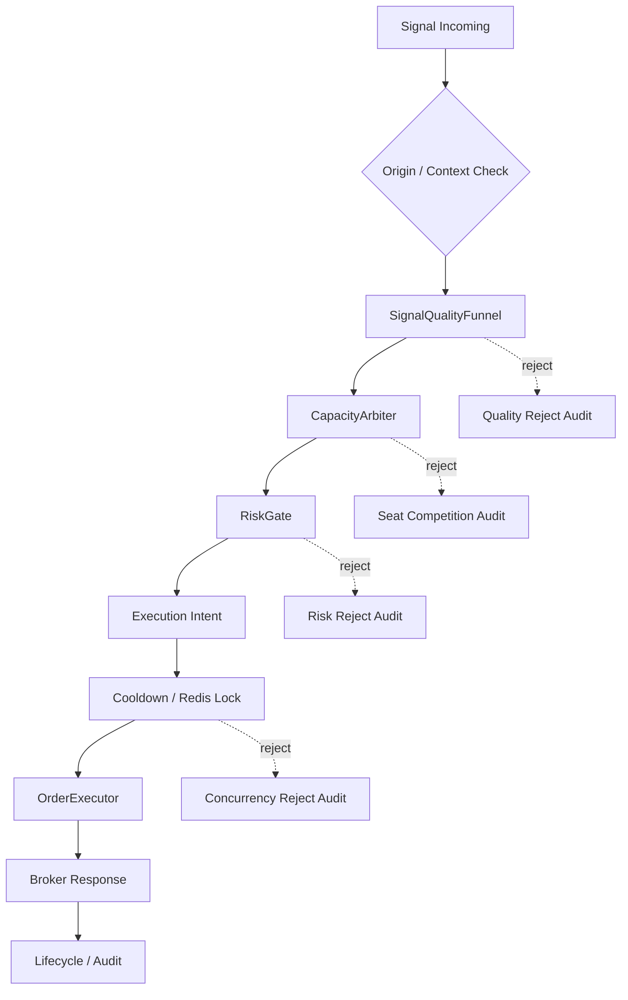
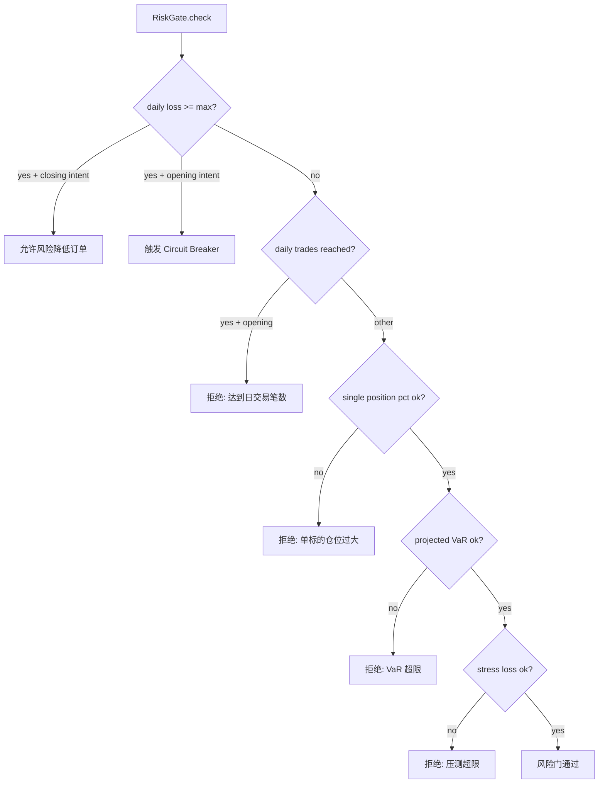
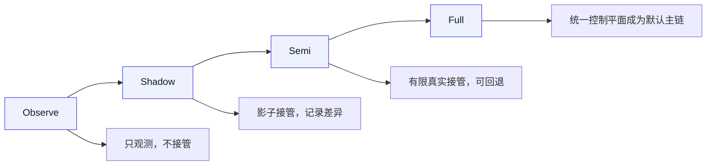

# 风控机制与治理控制

本文档描述系统如何在“信号可用”与“允许执行”之间建立多层防线，以及这些防线如何和体制、容量、审计、放量治理协同工作。

## 1. 设计原则

- 不把自动信号等同于自动成交。
- 风险降低优先于收益追逐，但仍然保留审计与执行语义。
- 满仓不是简单拒绝，而是席位竞争与替换治理问题。
- 体制、数据质量、审计真源与 rollout 阶段必须进入控制平面。

## 2. 风控分层图

## 3. 各层机制说明

### 3.1 Signal Origin 与上下文

目标：

- 区分 `REAL / SYNTHETIC / BACKFILL` 等来源语义。
- 将体制、账户、现有持仓、数据质量注入后续决策。

意义：

- 避免研究态、回补态或合成态信号误入生产自动执行。

### 3.2 SignalQualityFunnel

职责：

- 对开仓型信号做多层质量评估。
- 记录拒绝层级、原因码、质量分层、quota 豁免等元数据。

它解决的问题：

- 信号强度不足
- 体制不匹配
- 多维共振不足
- 置信度不达标

### 3.3 CapacityArbiter

职责：

- 在持仓位已满时，对“当前持仓 + 新开仓信号”进行统一评分。
- 决定谁保留席位、谁淘汰、是否需要先平后开。

它不是普通风控，而是容量治理。

关键特性：

- 统一候选池
- `admission_score` 排序
- 保护带、冷却期、每轮替换上限
- dry-run 与审计日志

### 3.4 RiskGate

职责：

- 在真正下单前执行硬性风险约束。

当前核心检查：

- 单标的仓位占比
- 组合 VaR 上限
- 压力测试损失上限
- 当日交易笔数上限
- 当日已实现亏损触发的 circuit breaker

特殊规则：

- `REDUCE / EXIT / STOP_LOSS_EXIT / FORCE_EXIT` 视为 risk-reducing intent
- risk-reducing intent 可跳过部分开仓型约束
- 在配置允许时，closing intent 可在 circuit breaker 期间放行

## 4. RiskGate 决策流程图

## 5. 体制、放量与治理

### 5.1 体制感知

体制通过以下路径影响风控：

- `RegimeClassifier` 识别市场 regime
- `TruthSourceService` 提供 regime truth snapshot
- `RiskGateService.set_regime_var_multiplier()` 调整体制感知 VaR 门限
- `AutonomousEngine` 在决策与审计中记录 `regime_at_decision`

### 5.2 Rollout 治理

在 V10.5.4 相关设计中，治理不是附属信息，而是生产安全边界。

### 5.3 Feature Flags 的作用

重要开关通常用于控制以下能力是否接管真实链路：

- signal pipeline 新语义
- autonomous control plane 收敛
- native audit 优先
- governance hard gate
- execution policy hard control

这些开关的本质不是功能展示，而是风险隔离和回滚抓手。

## 6. 审计与可解释性

系统要求每一次拒绝、跳过、执行都能尽量回答：

- 是哪个阶段做出的决定
- 为什么拒绝或放行
- 当时的 regime / quality tier / bypass_reason 是什么
- 是否是强制退出、容量替换、风控豁免或治理降级

对应记录面：

- Watchtower metadata
- autonomy audit log
- capacity decision audit log
- signal quality audit log
- execution intent 状态迁移

## 7. 对业务行为的真实影响

### 7.1 为什么好信号也可能不成交

因为系统要同时满足：

- 质量足够
- 容量允许
- 风险预算允许
- 没有命中熔断
- 没有重复执行或并发冲突

### 7.2 为什么风险退出要开快速通道

因为在真实交易系统里，降低风险通常优先于维持流程对称性。止损、强平、减仓如果还要排队经过全部开仓检查，会放大尾部风险。

### 7.3 为什么容量仲裁要和风控分开

因为容量问题回答的是“席位值不值得给你”，而风控问题回答的是“就算值得，也能不能承受”。两者不是同一个问题。

## 8. 排障建议

### 8.1 信号被拒绝时先看哪里

顺序建议：

1. Quality Funnel 审计
2. Capacity 决策审计
3. RiskGate reason/details
4. execution intent 状态
5. autonomy audit log

### 8.2 风险门频繁拒绝时看哪里

重点检查：

- 当前 equity 与持仓价格快照是否准确
- regime multiplier 是否异常偏紧
- projected position / VaR / stress 估算是否与最新持仓一致

## 9. 相关文档

- [system-architecture.md](system-architecture.md)
- [signal-trade-position-flows.md](signal-trade-position-flows.md)
- [job-orchestration.md](job-orchestration.md)