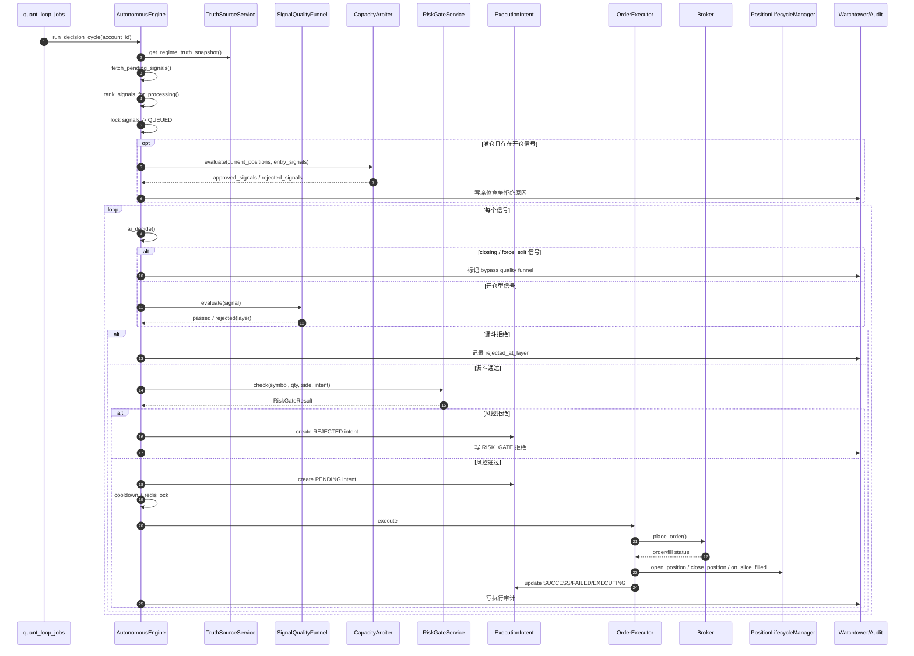
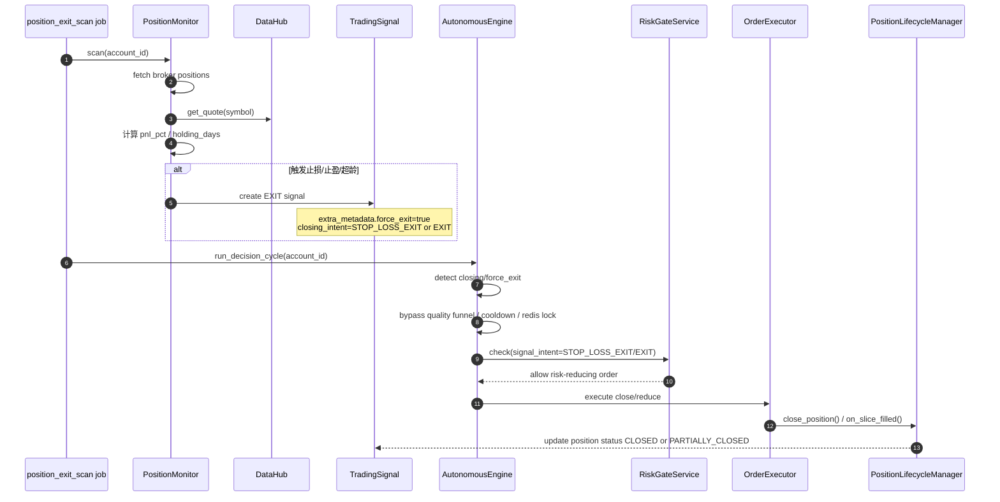
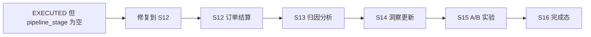
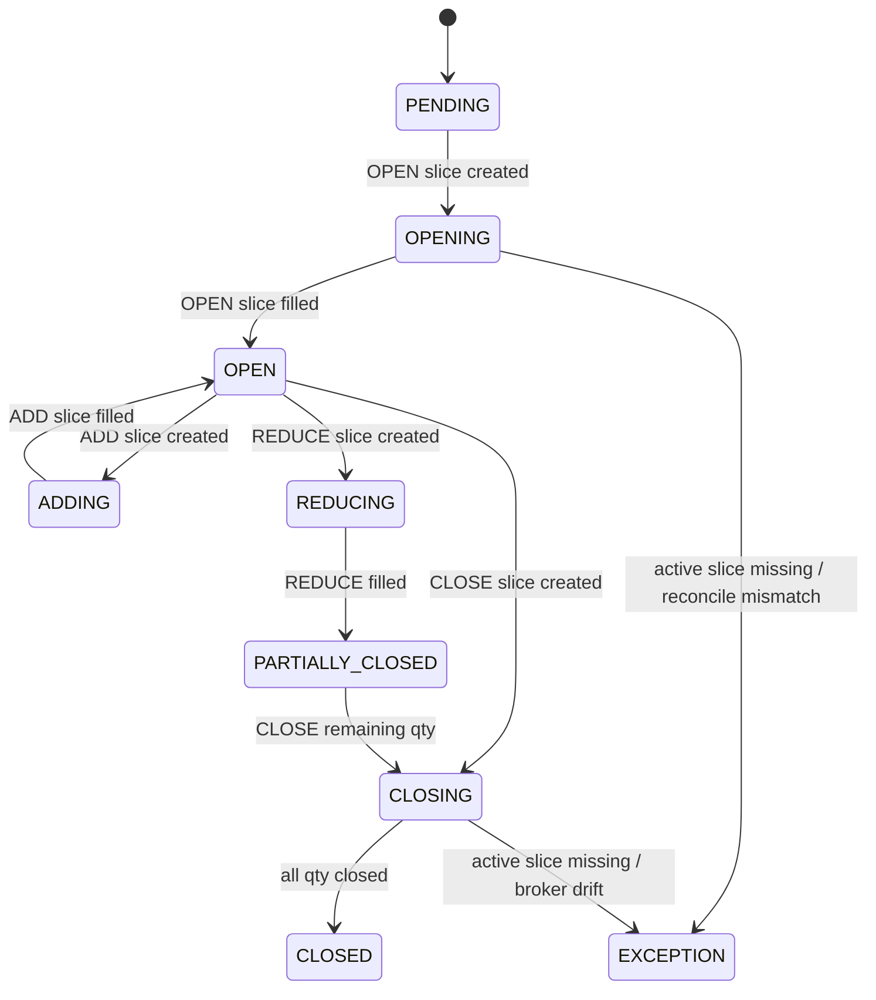

# 信号、交易与持仓数据流

本文档聚焦系统最核心的运行主链：从信号发现，到自动执行，再到持仓生命周期和交易后流水线。

## 1. 总览

系统中至少存在四条彼此耦合但职责不同的数据流：

- 信号流：策略、扫描器、持仓监控产生 `TradingSignal`
- 执行流：`AutonomousEngine` 评估后生成 `AutonomousExecutionIntent` 并调用 `OrderExecutor`
- 持仓流：`PositionLifecycleManager` 维护 `Position` 与 `ExecutionSlice`
- 交易后流：`PostTradePipelineService` 推进 S12-S16 的落库、归因、洞察与完成态

## 2. 信号到自动执行主时序

## 2.1 V11.0.1 反馈回路

V11.0.1 在原有主时序之外，新增一条“执行后反馈到控制平面”的元状态回路：

- 开仓信号在 `SignalQualityFunnel` 被连续拒绝时，写入 `ConvictionFrictionTracker`
- 持仓层连续生成 `REDUCE` 建议却未执行时，累积为 False-Hold Alert
- 每个周期结束后，`MetaStateSnapshotService` 聚合：
    - `throttled_signals`
    - `false_hold_alerts`
    - `capital_state`
    - `model_state`
- `ImprovementCandidateService` 基于元状态生成结构化改进候选
- 前端 `/autonomy` 统一消费上述反馈结果

关键提示：

- V11.0.1 不新增并行交易入口，而是补充“主链运行后的自感知反馈层”
- 反馈层解释“为什么没有成交 / 为什么没有释放资本”，而不是直接绕过既有风控

### 主执行链路关键结论

- 自动执行不是“查到 VALIDATED 就下单”，中间至少要经过容量、品质、风险、幂等、冷却、并发锁多层校验。
- 风险降低类信号是特例，会走快速通道，但依然保留 execution_intent 和审计语义。
- `execution_intent` 是信号与真实执行之间的桥梁，也是幂等和可观测性的关键。

## 3. 风险降低类持仓退出时序

该链路与开仓链路不同，入口来自现有持仓而不是策略研究信号。

### 退出链路关键结论

- `PositionMonitor` 负责发现风险退出条件，不直接下单。
- `AutonomousEngine` 依然是执行入口，只是对 closing intent 应用不同的控制策略。
- `RiskGate` 对 risk-reducing order 会跳过部分开仓型硬约束，并可在 circuit breaker 期间允许平仓。

## 4. 交易后流水线 S12-S16

对应实现：

- `PostTradePipelineService.advance_post_trade_plans()`
- `quant_loop_jobs.run_post_trade_pipeline_job()`

设计意图：

- 避免“成交结束即生命周期结束”的过早收口。
- 让归因、洞察、试验、完成态推进成为明确的后台流水线。
- 支持孤立 `EXECUTED` 计划修复到 S12 后继续推进，减少状态断裂。

## 5. Position 生命周期

对应实现核心：

- `PositionLifecycleManager.open_position()`
- `PositionLifecycleManager.close_position()`
- `PositionLifecycleManager.on_slice_filled()`

## 6. 真源与状态衔接

### 6.1 信号真源

- 研究/策略信号：`SignalEngine`
- 风险退出信号：`PositionMonitor`
- 容量置换 EXIT 信号：`CapacityArbiterService`

### 6.2 执行真源

- 执行请求真源：`AutonomousExecutionIntent`
- 实际落单真源：`OrderExecutor` + Broker 响应
- 成交回写真源：`OrderExecutor` 更新 intent/slice/position

### 6.3 持仓真源

- 当前持仓看板优先使用 `Position` 读模型，而不是仅依赖 broker fallback
- 生命周期中心同时观察 `TradingPlan.pipeline_stage` 与 `Position.status`

## 7. 常见阻塞点

### 7.1 信号生成了但没执行

优先排查：

- 是否被 `CapacityArbiter` 淘汰
- 是否被 `SignalQualityFunnel` 拒绝
- 是否被 `RiskGate` 拦截
- 是否命中 duplicate intent / cooldown / redis lock
- 是否处于 Observe / Shadow 阶段而未接管真实执行

### 7.2 券商已成交但持仓没收敛

优先排查：

- `OrderExecutor` 是否完成 slice fill 回写
- `PositionLifecycleManager.on_slice_filled()` 是否被调用
- 是否需要 broker reconcile 修复

### 7.3 计划停在 EXECUTED 不再前进

优先排查：

- `run_post_trade_pipeline_job()` 是否正常运行
- `PostTradePipelineService` 是否已修复孤立 EXECUTED 计划到 S12

## 8. 相关文档

- [system-architecture.md](system-architecture.md)
- [risk-and-governance.md](risk-and-governance.md)
- [job-orchestration.md](job-orchestration.md)