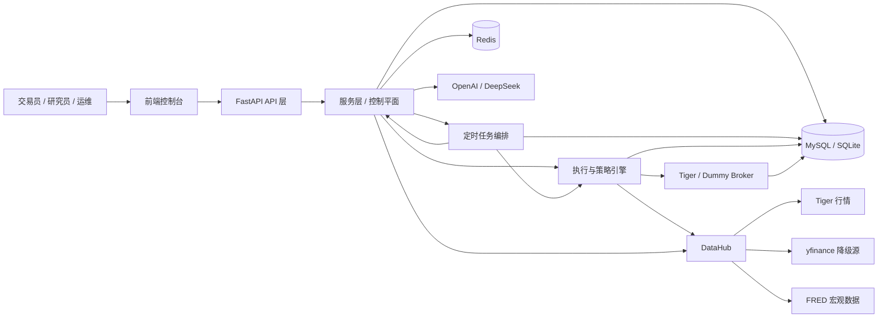
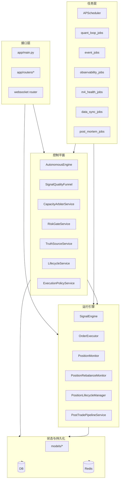
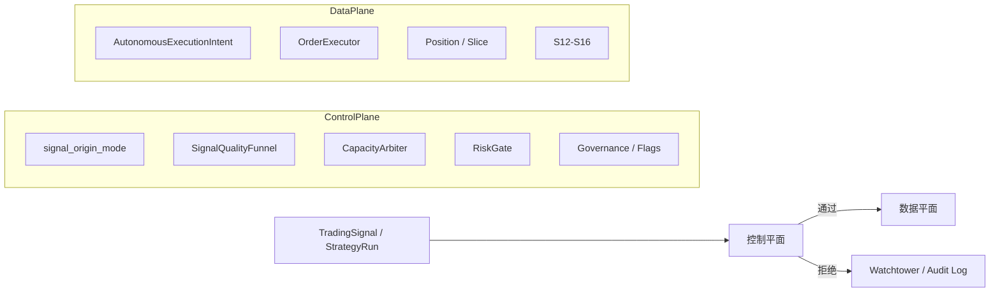

# 后端总体架构

本文档描述 AI Trading Backend V8 当前后端的系统边界、核心组件和控制平面分层。内容以当前实现为准，重点对应以下真实入口与模块：

- `app/main.py` - FastAPI 生命周期、路由挂载、Scheduler 初始化
- `app/routers/` - API 接入面
- `app/services/` - 业务服务与控制平面
- `app/engine/` - 信号、执行、持仓监控等运行引擎
- `app/jobs/` - APScheduler 周期任务编排
- `app/data/hub.py` - 多源行情与数据路由

## 1. 架构目标

系统不是单一的“自动下单服务”，而是一个围绕信号发现、风控校验、执行治理、持仓生命周期和交易后审计构建的交易控制平面。

关键目标：

- 将信号生成、风控校验、执行落单、持仓管理、归因复盘解耦。
- 用统一的控制平面约束自动执行，而不是让多个入口直接下单。
- 将体制、风险、容量、数据真源、审计日志纳入统一治理。
- 通过 Scheduler 持续驱动数据刷新、巡检、回补和 post-trade 流水线。

## 2. 系统上下文图

## 3. 后端组件图

## 3.1 V11.0.1 增量反馈层

V11.0.1 在既有控制平面之上新增一层“资本效率与系统自感知反馈层”，不改变 `AutonomousEngine` 作为唯一自动执行主链的定位，而是补充以下能力：

- `ConvictionFrictionTracker`：观察 near-miss 信号在 Layer 4 前后的阻断积累
- `MetaStateSnapshotService`：聚合系统快照，输出前端 `/autonomy` 所需的自知画像
- `ImprovementCandidateService`：根据元状态自动生成改进候选
- `CapitalVelocityService`：把“资金闲置”和“席位效率”转成可解释的控制面信号

这层能力的作用不是放宽 RiskGate，而是让系统知道“哪里堵住了资本周转”，并把反馈结构化暴露给观察与治理界面。

## 4. 分层职责

### 4.1 API 层

职责：

- 对外暴露统一的 `/api/v1/*` 接口。
- 挂载自治、生命周期、可观测性、风控、执行策略、治理等路由组。
- 做鉴权、序列化、路由聚合，不承载核心交易决策。

对应：

- `app/main.py`
- `app/routers/autonomy.py`
- `app/routers/lifecycle.py`
- `app/routers/system_monitor.py`
- `app/routers/execution_policy.py`

### 4.2 控制平面

职责：

- 决定信号是否进入自动执行主链。
- 统一体制、容量、风险、真源、审计语义。
- 保证自动执行由主链编排而非分散服务绕过。

关键组件：

- `AutonomousEngine`：自动执行主编排入口。
- `SignalQualityFunnel`：五层信号质量过滤。
- `CapacityArbiterService`：满仓场景的席位竞争与替换决策。
- `RiskGateService`：最终硬风控门。
- `TruthSourceService`：统一 positions/regime/audit 读模型来源。
- `LifecycleService`：流水线分布、FSM、生命周期可观测视图。

### 4.3 运行引擎层

职责：

- 负责信号生成、订单执行、持仓监控、切片成交回写、交易后推进。
- 将控制平面的决策落实为实际运行动作。

关键组件：

- `SignalEngine`：生成、校验、查询待处理信号。
- `OrderExecutor`：提交券商订单并同步 execution intent、切片、成交状态。
- `PositionMonitor`：扫描止损、止盈、超龄持仓，生成风险降低类 EXIT 信号。
- `PositionLifecycleManager`：Position + ExecutionSlice 聚合根与状态变更。
- `PostTradePipelineService`：驱动 S12-S16 交易后流水线。

### 4.4 任务层

职责：

- 将周期性运行从 API 请求中解耦出来。
- 驱动日内自动交易、数据刷新、观测快照、健康检查、post-mortem 和回补任务。

关键特点：

- 由 `app/jobs/scheduler.py` 使用 APScheduler 统一管理。
- 启动时在 `app/main.py` 中集中注册。
- 既有盘中 market-guard 任务，也有盘后/全天候修复与审计任务。

## 5. 控制平面与数据平面

说明：

- 控制平面回答“是否允许执行”。
- 数据平面回答“如何执行、怎样落库、如何推进生命周期”。
- 两者之间通过 `execution_intent`、Watchtower 元数据和生命周期事件连接。

## 6. 真源策略

系统中最容易出现偏差的不是下单逻辑，而是“读模型口径漂移”。当前设计明确强调以下真源：

- 市场体制真源：`TruthSourceService.get_regime_truth_snapshot()`
- 持仓看板真源：`TruthSourceService.get_positions_read_model()` + Position lifecycle 数据
- 自动执行真源：`AutonomousEngine.run_decision_cycle()` + `AutonomousExecutionIntent`
- 生命周期真源：`Position` / `ExecutionSlice` / `TradingPlan.pipeline_stage`

这也是系统监控、生命周期中心、Order Book、Autonomy 页面能够对齐的基础。

## 7. 重要设计结论

### 7.1 为什么 AutonomousEngine 是主链

因为它是当前最完整的控制点，串联了：

- 待处理信号查询
- 体制上下文注入
- 质量漏斗
- 席位竞争
- RiskGate
- execution_intent 幂等保护
- 冷却与 Redis 并发锁
- 下单执行与审计落库

### 7.2 为什么 Position 要独立成聚合根

因为计划、委托、切片、持仓已不是 1:1 关系，尤其是在以下场景：

- 加仓 / 减仓 / 分批成交
- 强制平仓 / odd-lot 退出
- capacity displacement 导致的先出后进
- 盘后 reconciliation 与状态修复

### 7.3 为什么 Scheduler 是核心运行面而不是附属工具

因为该系统的大量关键能力依赖周期驱动，而不是同步请求：

- 日内自动交易循环
- 持仓止损止盈巡检
- post-trade 流水线推进
- 数据刷新与真源校验
- 事件日历、体制、归因、校准、post-mortem 等后台任务

## 8. 相关专题

- [signal-trade-position-flows.md](signal-trade-position-flows.md)
- [risk-and-governance.md](risk-and-governance.md)
- [job-orchestration.md](job-orchestration.md)